2026年10月20日，蓝色技术工作室换届大会暨新生见面会于学术报告厅顺利举行。工作室指导老师与全体新老成员齐聚现场，完成换届交接、成果分享、互动抽奖等系列环节，共赴科创新征程。

---

2026年10月20日，蓝色技术工作室换届大会暨新生见面会于学术报告厅顺利举行。工作室指导老师与全体新老成员齐聚现场，完成换届交接、成果分享、互动抽奖等系列环节，共赴科创新征程。

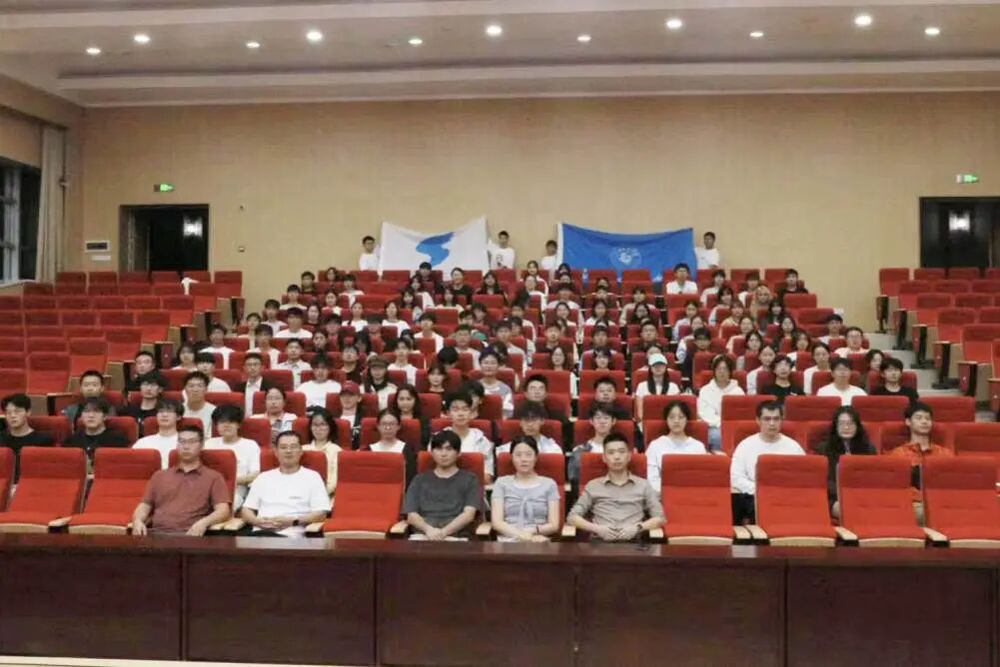

  

**风采展示：硕果累累，科创底色**

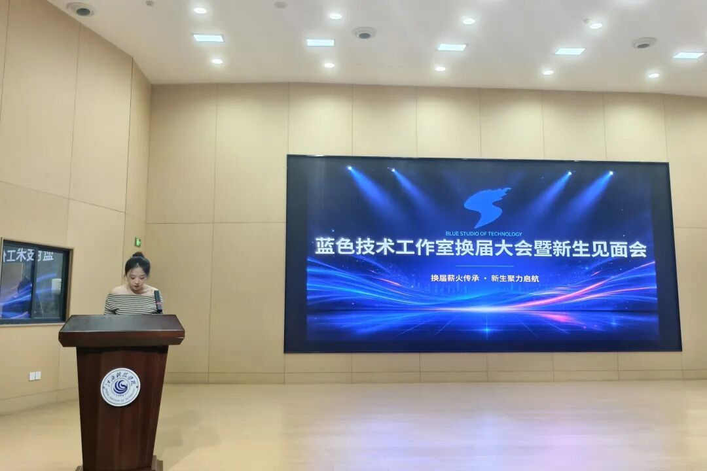

活动伊始，主持人杨倩向全体成员展示发展概况与竞赛成果。蓝色技术工作室2011年由信息工程学院成立，是全国高校活力社团TOP100科技类社团。2024年底完成转型，深耕AI智能体、机器人等前沿方向。工作室累计斩获国家级奖项80余项、省级奖项400余项，一项项竞赛荣誉，充分展现工作室扎实的科创实力。

**师长寄语：殷殷嘱托，指引方向**

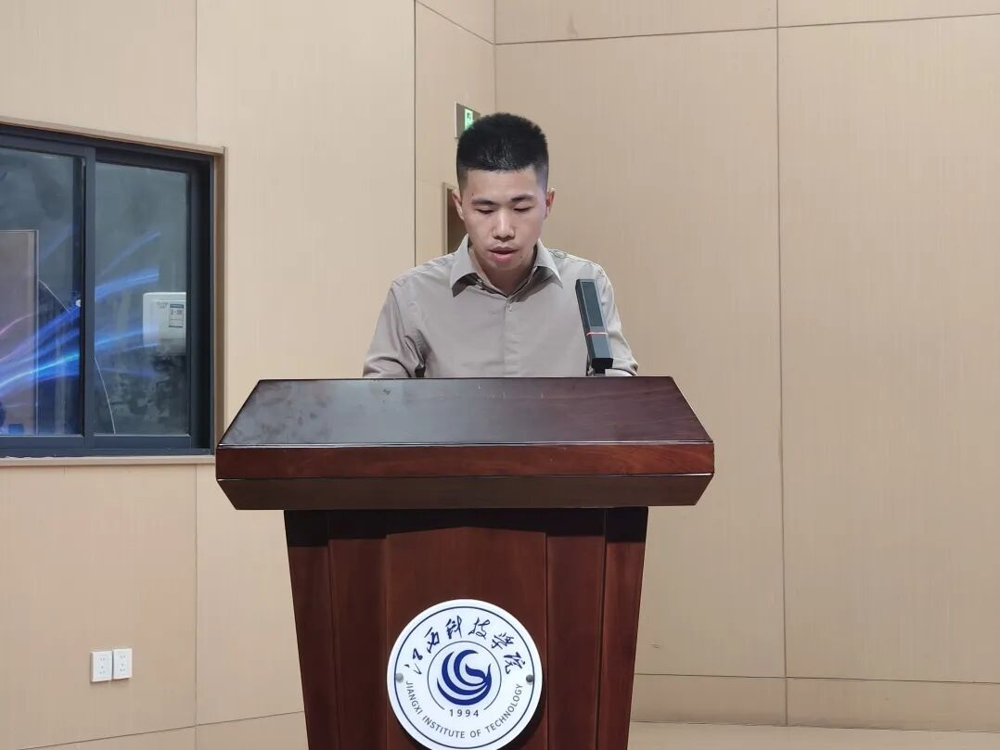

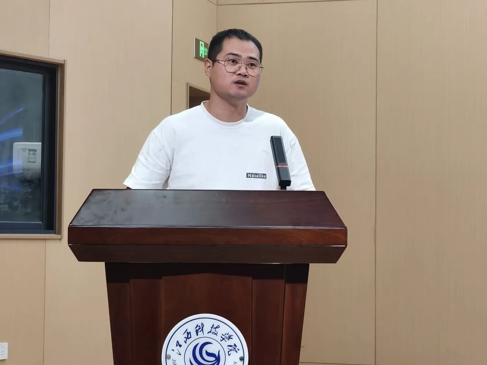

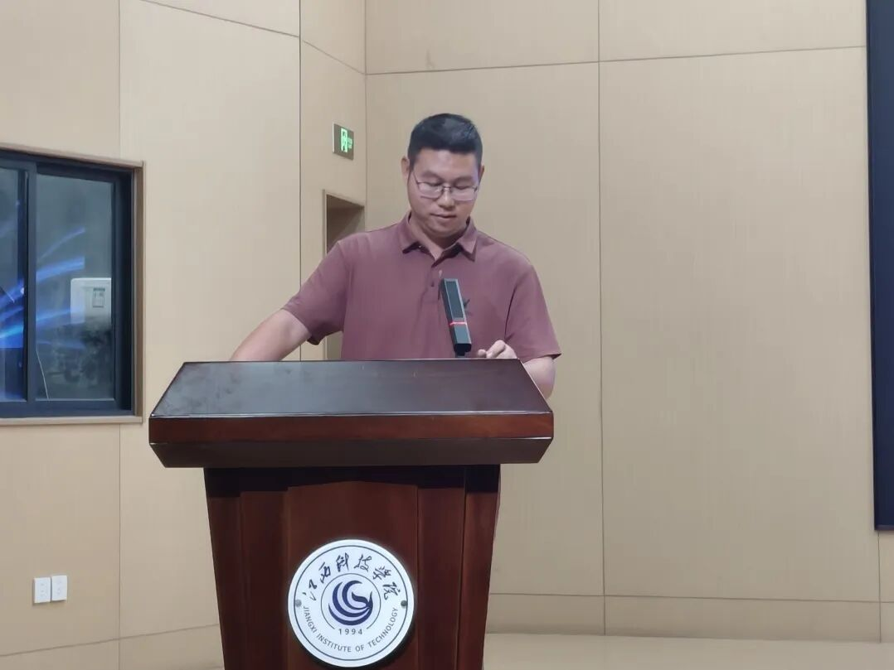

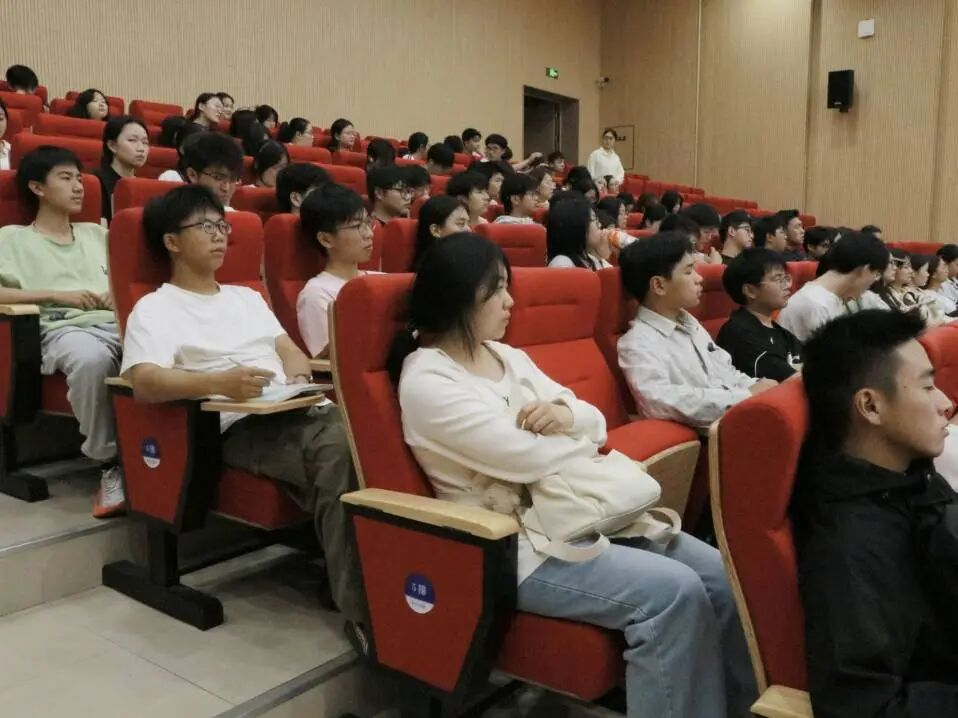

随后，吴立胜老师、戴仁村老师以及李钦华老师依次上台发言。三位老师充分肯定工作室过往竞赛成绩，介绍新学年锡焊实操、Python、AI大模型的分层培养方案，明确各项备赛规划。同时勉励新成员不必畏惧基础薄弱，秉持“边做边学”理念，敢于试错、主动钻研，向着更高竞赛目标奋力冲刺。

**继往开来：薪火赓续，接力启航**

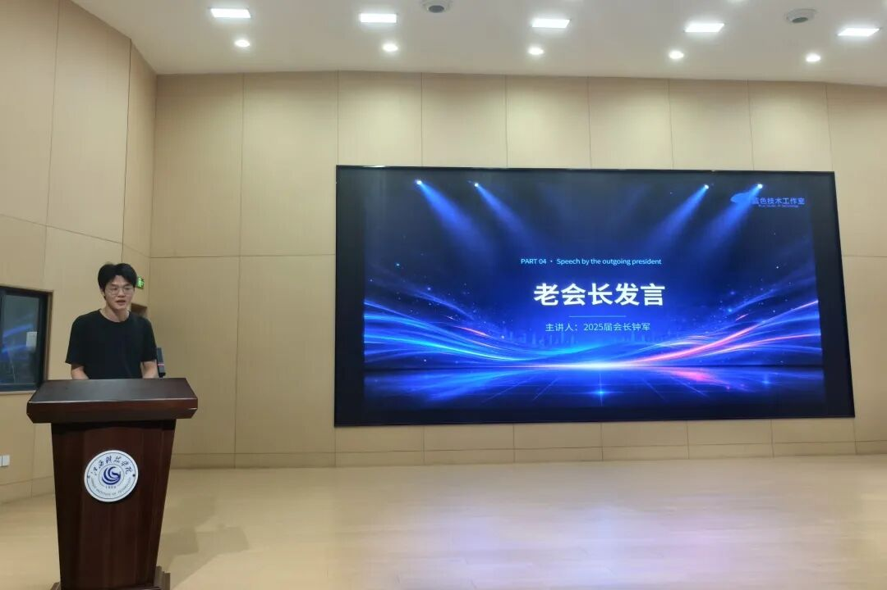

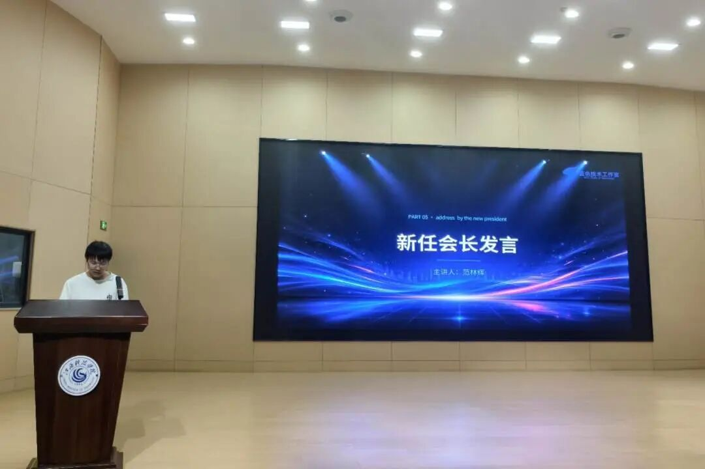

上一任会长钟军回顾任期工作，感谢老师与全体成员的付出，表示将持续支持工作室发展；新任会长范林辉发表就职表态，以“传承、创新、服务”为核心规划团队未来发展，立志带领工作室迈向新高度。

**薪火相传：聘书授予，使命接力**

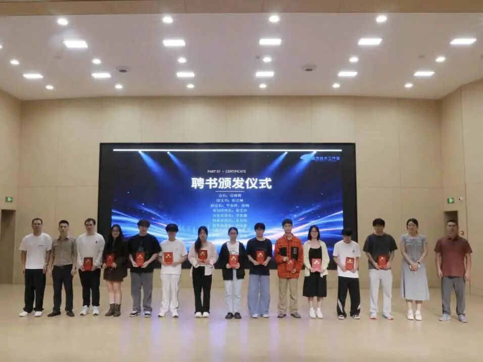

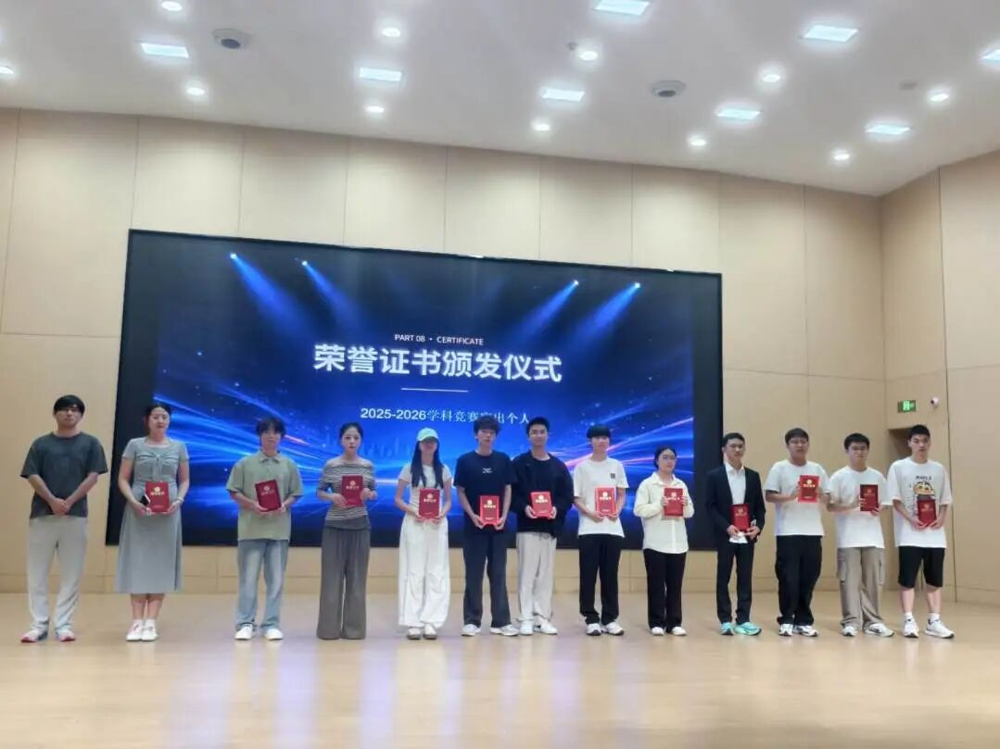

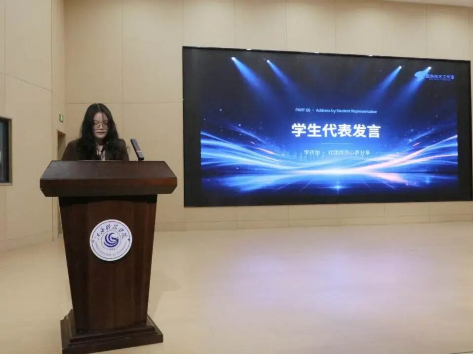

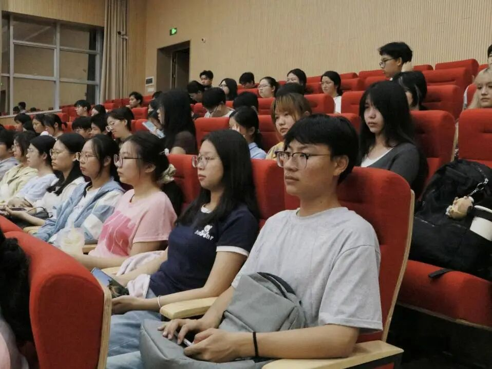

在全场成员见证下，大会开展聘书颁发仪式，为上一届骨干颁发荣誉聘书，新一届管理团队正式接过接力棒。新的聘书，承载的是一份信任，更是一份科创使命的传递。新生代表李佳怡上台分享成长感悟，表示会做好传帮带，助力新成员快速成长。

**趣味互动：幸运抽奖，凝聚氛围**

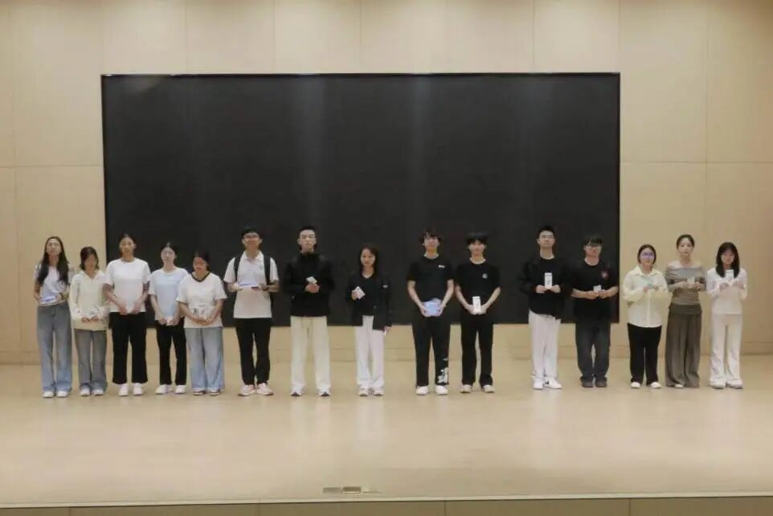

大会设置全员大屏抽奖环节，依次送出U盘、拓展坞、51单片机科创奖品。全体师生共同参与，现场气氛热烈，让庄重的换届仪式增添了活泼的青春气息。

**结语**
本次大会的圆满落幕，标志着蓝色技术工作室翻开全新篇章。薪火已接续，新程已开启，相信在指导老师的引领、新老成员的共同努力下，蓝色技术工作室定能深耕科创赛道，接续再创佳绩！

文字 | 阳芷琳 李依璐

图片 | 阳芷琳 李依璐

排版 | 阳芷琳 李依璐

审校 | 钟 军 范林辉